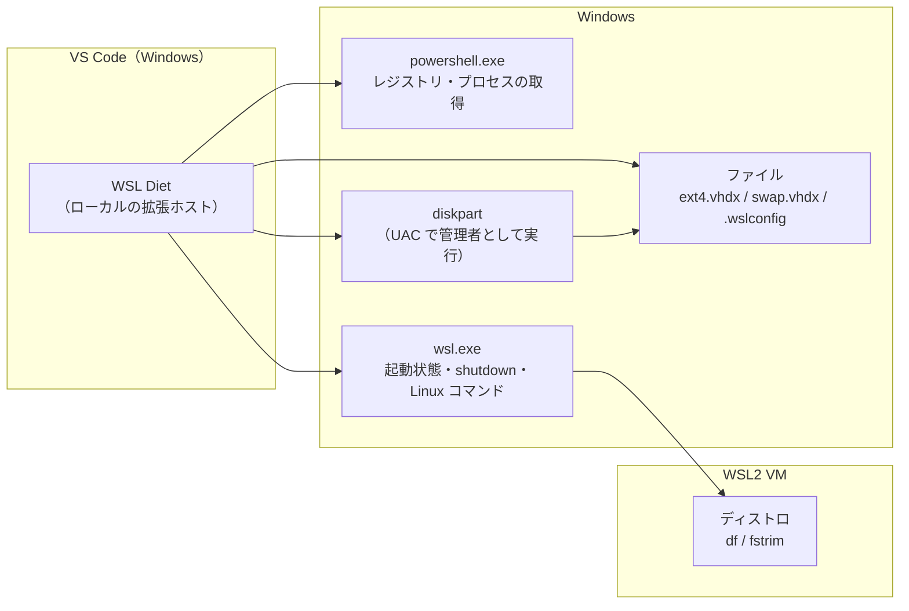

# 01. 概要

## 目的

WSL2 のディストロは、Linux 内のファイルを仮想ディスク（`ext4.vhdx`）に保存する。vhdx は使うほど大きくなるが、Linux 内でファイルを消しても自動では縮まない。また、WSL のスワップ領域（`swap.vhdx`）も Windows 側のディスクを消費する。

WSL Diet は次のことを VS Code の中で行う。

- vhdx と swap.vhdx のサイズを常に見えるようにする
- 必要なときに、swap.vhdx の削除と vhdx の圧縮を安全に行う

## 用語

| 用語 | 意味 |
|---|---|
| ディストロ | WSL に登録された Linux ディストリビューション（例: `Ubuntu-22.04`） |
| vhdx / ext4.vhdx | ディストロの仮想ディスク。ファイル名は通常 `ext4.vhdx` |
| swap.vhdx | WSL2 の VM が使うスワップ領域の仮想ディスク。既定では `%TEMP%\<VM の ID>\swap.vhdx` |
| 対象ディストロ | ステータスバーに表示し、圧縮する対象のディストロ。設定 `compactWsl.distro` で指定し、空なら WSL の既定のディストロ |
| Windows 側のウィンドウ | WSL に接続していない VS Code のウィンドウ（`vscode.env.remoteName !== 'wsl'`） |
| WSL のウィンドウ | Remote - WSL で WSL に接続している VS Code のウィンドウ（`vscode.env.remoteName === 'wsl'`） |
| WSL クライアント | WSL を使っている Windows 側のプロセス。VS Code の WSL ウィンドウ、Windows Terminal の WSL タブ、Docker Desktop など |

## 全体構成



### Windows 側で動かす理由

`package.json` で `"extensionKind": ["ui"]` を指定している。これにより、拡張は WSL のウィンドウでも常に Windows 側（ローカル）の拡張ホストで動く。

- `wsl --shutdown` で WSL を止めても、拡張自身は止まらない
- Node.js の `fs` と `child_process` で、Windows のファイルとコマンドを直接扱える

拡張が Windows 以外で動いていることを起動時に検出した場合（WSL 側の拡張ホストに入れられた場合など）は、ステータスバーに `⚠ WSL Diet` と表示するだけで、他の処理は行わない。

### 起動

`activationEvents: ["onStartupFinished"]` により、VS Code の起動が終わった後に自動で起動する。

## モジュール構成

```
src/
  extension.ts      エントリポイント。ステータスバーとタイマー、コマンドの登録、メニュー
  config.ts         設定の読み込み
  snapshot.ts       状態（ディストロ、vhdx サイズ、swap.vhdx）の取得
  statusBar.ts      ステータスバーとツールチップの表示
  status.ts         詳細表示（Show Status）
  compact.ts        圧縮と swap 削除の流れ（事前チェック → 確認 → 実行 → 通知）
  format.ts         バイト数・日数の表示用の関数
  win/
    exec.ts         Windows コマンドの実行（wsl.exe / powershell.exe）
    decode.ts       Windows コマンドの出力のデコード（UTF-16LE / UTF-8）
    distro.ts       レジストリからのディストロ一覧の取得、df 出力の解析
    swap.ts         swap.vhdx の検出と削除、.wslconfig の解析
    wslClients.ts   WSL クライアントの検出
    diskpart.ts     diskpart による vhdx の圧縮
test/               単体テスト（node:test）
```

`win/` 以下と `format.ts` は `vscode` モジュールに依存しない。解析処理は純粋な関数に分けてあり、WSL 上の Node.js で単体テストできる。
