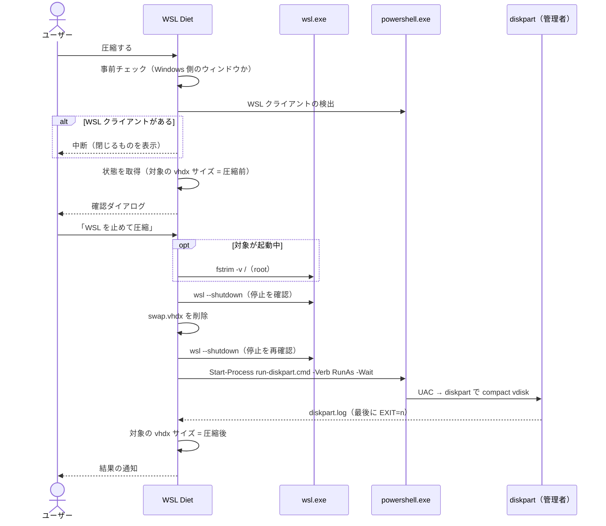

# 02. 機能

## コマンド一覧

| コマンド ID | コマンドパレットの表示 | WSL のウィンドウ | 内容 |
|---|---|---|---|
| `compactWsl.menu` | WSL Diet: Menu | 使える | メニューを開く（ステータスバーをクリックしたときと同じ） |
| `compactWsl.showStatus` | WSL Diet: Show Status | 使える | 詳細を表示する |
| `compactWsl.refresh` | WSL Diet: Refresh Size | 使える | サイズを測り直す |
| `compactWsl.compact` | WSL Diet: Compact | **使えない** | swap.vhdx の削除と vhdx の圧縮 |
| `compactWsl.deleteSwap` | WSL Diet: Delete Swap Only | **使えない** | swap.vhdx の削除だけ |

WSL のウィンドウでは、`compact` と `deleteSwap` をコマンドパレット（`menus.commandPalette` の `when: remoteName != wsl`）にもメニューにも出さない。別の方法で実行された場合も、事前チェックでエラーにする（→ [圧縮](#圧縮compact)）。

## ステータスバー

### 表示

| 状態 | テキスト | 背景 |
|---|---|---|
| 通常 | `$(database) WSL 43.9GB`（対象ディストロの vhdx サイズ） | なし |
| しきい値以上 | 同上 | 警告色（`statusBarItem.warningBackground`） |
| 対象の vhdx が見つからない | `$(database) WSL ?` | なし |
| 状態を取得できない（例外） | `$(database) WSL ?`（ツールチップにエラー内容） | なし |
| Windows 以外で動いている | `$(warning) WSL Diet` | なし |

- サイズは vhdx のファイルサイズを 1024³ で割った GB で表す（エクスプローラーの表示と同じ計算）。1GB 未満は MB で表す
- しきい値は設定 `compactWsl.warnThresholdGB`
- クリックするとメニューを開く

### ツールチップ

Markdown で次の内容を表示する。

- しきい値以上なら「○GB を超えています」
- 全ディストロの表: 名前（対象には ★）、vhdx サイズ、状態（`既定` / `起動中` または `停止` / `○日未使用`）
- swap.vhdx の合計サイズ（無ければ「なし」）

`○日未使用` は、vhdx の最終更新日時から 30 日（`STALE_DAYS`）以上たっているときに付ける。

### 更新のタイミング

- 起動時
- 設定 `compactWsl.pollIntervalMinutes`（分）ごと
- `compactWsl.*` の設定が変わったとき（間隔も作り直す）
- `Refresh Size`、`Compact`、`Delete Swap Only` の実行後

更新では WSL を起動しない（→ [03 の起動状態の取得](03-windows-integration.md#起動中のディストロ)）。

## メニュー

QuickPick で次の項目を出す。

| 項目 | Windows 側のウィンドウ | WSL のウィンドウ |
|---|---|---|
| 詳細を表示 | ○ | ○ |
| 圧縮する | ○ | 出さない |
| swap だけ削除 | ○ | 出さない |
| サイズを再計測 | ○ | ○ |

WSL のウィンドウでは、プレースホルダーに「削除と圧縮は、WSL に接続していない Windows 側のウィンドウから実行できます」と表示する。

## 詳細表示（Show Status）

モーダルダイアログで次の内容を表示する。

ディストロごと:

- 名前、`(既定)`、対象なら `★対象`
- vhdx のサイズとパス（見つからなければ「見つかりません」）
- 起動中なら Linux 内の使用量（`df -B1 --output=used /`）と「取り戻せる見込み: 最大 約 ○GB」（vhdx サイズ − 使用量）
- 停止中なら「停止中のため Linux内の使用量は未計測」（使用量を調べるために WSL を起動することはしない）
- 30 日以上更新がなければ、`wsl --unregister <名前>` で削除できることの案内

swap.vhdx ごと: サイズとパス（無ければ「なし」）

「取り戻せる見込み」が「最大」なのは、`df` の使用量に ext4 の管理情報（ジャーナル、書き込み済みの inode テーブルなど）が含まれないためである。管理情報も vhdx の中で場所を取るので、実際に縮む量はこれより少ない。

## 圧縮（Compact）

`src/compact.ts` の `runCompact(ctx, targetName, 'compact')`。

### 1. 事前チェック

| 条件 | 動作 |
|---|---|
| WSL のウィンドウから実行された | エラー「削除と圧縮は、WSL に接続していない Windows 側のウィンドウから実行してください。」で終了 |
| WSL クライアントがある | 警告のモーダル「WSL を使っているものがあるため中断しました」で終了。VS Code の WSL ウィンドウがあるか、その他が何件あるかを表示する |
| 対象の vhdx が見つからない | エラー「対象のディストロの vhdx が見つかりません。設定 compactWsl.distro を確認してください。」で終了 |

WSL クライアントがあると、`wsl --shutdown` の直後に WSL が起動し直され、swap.vhdx の削除や vhdx の圧縮ができない。自動で閉じる方法はとらず、利用者に閉じてもらう（未保存のファイルがあるウィンドウを勝手に閉じないため）。

### 2. 確認ダイアログ

警告のモーダル「WSL がすべて停止します」。本文:

- 開いているファイルや、WSL 内で動いている作業を保存するよう促す
- 圧縮には UAC の確認が出ること
- 初回だけ、`wsl --export <ディストロ> D:\backup\<ディストロ>.tar` によるバックアップを勧める（→ [04 の状態](04-settings-and-state.md#globalstate)）

ボタン「WSL を止めて圧縮」を押したときだけ続ける。

### 3. 実行

進み具合を通知領域に表示しながら、次を順に行う。

1. **fstrim**（対象が起動中のときだけ）: `wsl.exe -d <対象> -u root -- sh -c "fstrim -v /"`（タイムアウト 10 分）。削除済みのブロックを vhdx に伝えるための処理で、これをしないと圧縮しても縮まない。結果は確認しない
2. **shutdown**: `wsl --shutdown` の後、起動中のディストロが無くなるまで 1 秒ごとに確認する（最大 60 秒）。止まらなければエラー「WSL が停止しませんでした。」で終了
3. **swap.vhdx の削除**: 事前に取得した swap.vhdx をすべて削除する（→ [03 の swap.vhdx](03-windows-integration.md#swapvhdx)）
4. **shutdown の再確認**: 2 と同じ。事前チェックの後に何かが WSL を起動した場合に備える
5. **diskpart**: 対象の vhdx を圧縮する（→ [03 の diskpart](03-windows-integration.md#diskpart-による圧縮)）

### 4. 結果の通知

圧縮後のサイズは、diskpart が成功したときだけ vhdx のファイルサイズを測り直す。

| diskpart の結果 | 通知 |
|---|---|
| 成功 | 情報「`<ディストロ>: 43.9GB → 40.2GB（-3.7GB）` / swap.vhdx の結果」 |
| UAC がキャンセルされた | 警告「UAC がキャンセルされたため圧縮はしていません。」＋ swap.vhdx の結果 |
| 失敗 | エラー「diskpart が失敗しました（終了コード n）。」＋ swap.vhdx の結果。「ログを開く」で diskpart.log の内容を新しいエディタに開く |

swap.vhdx の結果は「swap.vhdx ○MB を削除」または「swap.vhdx はありませんでした」。削除できなかったものがあれば「swap.vhdx ○ 件は削除できませんでした」を加える。

## swap だけ削除（Delete Swap Only）

`runCompact(ctx, targetName, 'swapOnly')`。圧縮と同じ流れで、次の点が違う。

- 確認ダイアログのボタンは「WSL を止めて swap を削除」。UAC の説明は出さない
- 実行するのは shutdown と swap.vhdx の削除だけ（fstrim、shutdown の再確認、diskpart は行わない）
- 管理者権限は不要
- 通知は swap.vhdx の結果だけ
